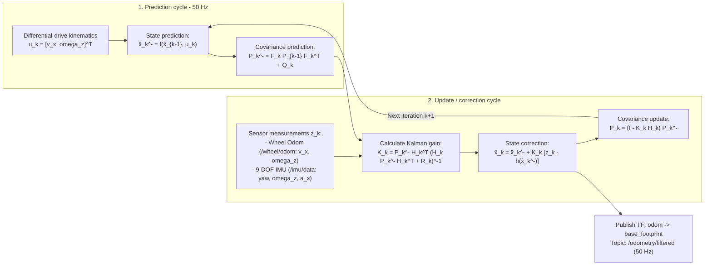
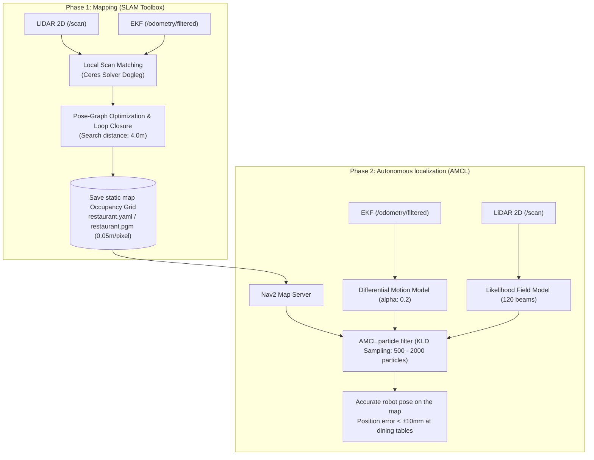
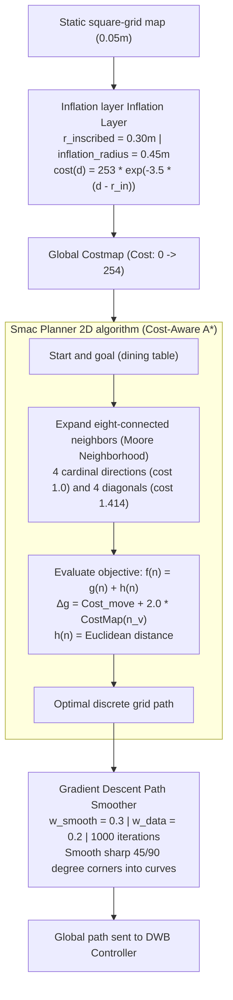
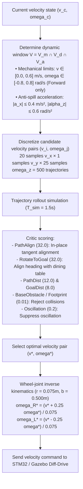

## 5.4. Navigation algorithms

For safe, stable operation in the restaurant environment modeled after Pizza 4P's Landmark 72, the ROS 2 Nav2 navigation system consists of four main algorithm blocks:
1. **State estimation and sensor fusion:** Extended Kalman filter ([EKF - robot_localization](file:///home/quangtran/Projects/capstone_ros2/src/amr_localization/config/ekf.yaml)).
2. **Mapping and global localization:** [SLAM Toolbox](file:///home/quangtran/Projects/capstone_ros2/src/amr_navigation/config/slam_toolbox.yaml) (mapping mode) and [Nav2 AMCL](file:///home/quangtran/Projects/capstone_ros2/src/amr_navigation/config/nav2_params.yaml#L6-L51) (autonomous service mode).
3. **Global path planning:** [Smac Planner 2D](file:///home/quangtran/Projects/capstone_ros2/src/amr_navigation/config/nav2_params.yaml#L225-L247) combined with a gradient-descent path smoother (Gradient Descent Path Smoother).
4. **Local trajectory tracking and dynamic obstacle avoidance:** [DWB Controller](file:///home/quangtran/Projects/capstone_ros2/src/amr_navigation/config/nav2_params.yaml#L98-L155) with anti-spill constraints (Anti-Spill Dynamics) and forward-only mode (Forward-Only Trajectory Rollout).

---

### 5.4.1. EKF algorithm (Extended Kalman Filter)

LiDAR alone cannot continuously determine robot position because its scan frequency is limited to 10 Hz. Between scans, continuous odometry from wheel encoders and the gyroscope/accelerometer of the 9-DOF IMU is needed. EKF fuses these two sources before supplying the navigation layer.

EKF repeatedly performs two main steps:

*   **Prediction:** After each time step $\Delta t$, EKF extrapolates the next pose using velocity commands and differential-drive kinematics. Mechanical effects and micro-slippage increase uncertainty $P$ according to process noise $Q$:
    $$P_k^- = F_k P_{k-1} F_k^T + Q_k$$
*   **Update:** When new encoder and IMU measurements $z_k$ arrive, EKF compares measurements with predictions through measurement matrix $H_k$. Kalman gain $K$ acts as a confidence factor:
    $$K_k = P_k^- H_k^T (H_k P_k^- H_k^T + R_k)^{-1}$$
    *   **Case 1:** When wheels slip on smooth tiles, model uncertainty $P$ rises ($K \to 1$), increasing trust in external measurements, especially the IMU gyroscope.
    *   **Case 2:** Sudden vibrations at floor joints increase measurement noise $R$ ($K \to 0$), increasing trust in the kinematic prediction from the wheels.

#### a) Input sensor sampling rates and multi-rate fusion

AMR sensors operate at different physical sampling rates to balance dynamic sensitivity and processing bandwidth. The following table lists their individual operating rates:

| Sensor / Module | Configured frequency | Sampling period ($\Delta t$) | Basis and configuration file | Engineering rationale |
| :--- | :--- | :--- | :--- | :--- |
| **9-DOF IMU (Bosch BNO055)** | **100.0 Hz** | $10\text{ ms}$ | `update_rate: 100` ([imu.xacro](file:///home/quangtran/Projects/capstone_ros2/src/amr_description/urdf/imu.xacro#L44)) | The 100 Hz gyroscope detects sudden angular-velocity changes at slip onset or when starting turns, improving yaw drift compensation and removing phase delay. |
| **Wheel Encoder (BLDC motor)** | **50.0 Hz** | $20\text{ ms}$ | `odom_publish_frequency: 50` ([gazebo.xacro](file:///home/quangtran/Projects/capstone_ros2/src/amr_description/urdf/gazebo.xacro#L30)) | The 20 ms wheel-feedback period provides sufficient velocity differentiation resolution without overloading STM32 interrupt queues or UART/CAN traffic to the ROS 2 computer. |
| **EKF filter (`ekf_filter_node`)** | **50.0 Hz** | $20\text{ ms}$ | `frequency: 50.0` ([ekf.yaml](file:///home/quangtran/Projects/capstone_ros2/src/amr_localization/config/ekf.yaml#L7)) | The EKF cycle matches 50 Hz wheel odometry, continuously supplying /odometry/filtered and odom -> base_footprint TF to the 10 Hz DWB controller. |
| **2D LiDAR (RPLIDAR A2M8)** | **10.0 Hz** | $100\text{ ms}$ | `update_rate: 10` ([lidar.xacro](file:///home/quangtran/Projects/capstone_ros2/src/amr_description/urdf/lidar.xacro#L63)) | The RPLIDAR A2 head rotates at 10 revolutions/s (600 RPM). Its 100 ms scan gap motivates EKF at 50–100 Hz to interpolate robot pose between scans. |

**Asynchronous multi-rate fusion:**
The `ekf_node` (`robot_localization`) operates asynchronously using ROS 2 header timestamps:
* Every **10 ms**, an incoming IMU packet (100 Hz) triggers correction of heading $\psi$ and acceleration $a_x$.
* Every **20 ms**, an incoming wheel-odometry packet (50 Hz) triggers kinematic prediction and correction of linear velocity $v_x$.
* Between LiDAR frames 100 ms apart, EKF performs **5 encoder updates** and **10 IMU updates**, smoothing pose and eliminating jerks during high-speed turns.

#### b) ROS 2 parameters for node `ekf_filter_node` ([ekf.yaml](file:///home/quangtran/Projects/capstone_ros2/src/amr_localization/config/ekf.yaml))

| Configuration parameter | Configured value | Design rationale and technical basis |
| :--- | :--- | :--- |
| `frequency` | `50.0` Hz | Publishes filtered pose /odometry/filtered and TF every 20 ms, matching wheel odometry and running five times faster than DWB (10 Hz). |
| `two_d_mode` | `true` | Constrains the robot to a flat 2D floor ($z=0$). Forcing $z$, roll, and pitch to zero removes vertical drift from vibrations at tile joints. |
| `sensor_timeout` | `0.1` s | If a sensor disconnects or is delayed beyond 100 ms (five encoder or ten IMU periods), EKF temporarily stops using that measurement to avoid corrupting the estimate. |
| `publish_tf` | `true` | Publishes the continuous REP-105 transform: `odom -> base_footprint`. |
| `odom0` (`/wheel/odom`) | `odom0_config`: `[vx: true, vyaw: true]` *(all other fields `false`)* | **Differential velocities only:** Forward velocity $\dot{x}=v_x$ and yaw rate $\dot{\psi}=\omega_z$. Do not fuse absolute wheel-integrated $(x,y)$: slipping during contact could introduce permanent accumulated position error. |
| `imu0` (`/imu/data`) | `imu0_config`: `[yaw: true, vyaw: true, ax: true]` `imu0_relative: true` `imu0_remove_gravitational_acceleration: true` | **Heading, yaw rate, and forward acceleration:** BNO055 heading $\psi$ and yaw rate $\dot{\psi}=\omega_z$ (100 Hz) are independent of wheel slip and eliminate heading errors. Acceleration $a_x$ supports emergency braking. `imu0_relative: true` sets initial heading to zero and automatically removes gravitational acceleration of 9.81 m/s². |
| `process_noise_covariance` ($Q$) | Diagonal $15 \times 15$: • $x, y, z: 0.01$ • $\text{roll}, \text{pitch}: 0.01$ • $\text{yaw}: 0.02$ • $v_x, v_y: 0.02$, $v_z: 0.01$ • $\dot{\psi} (\text{vyaw}): 0.02$ • $a_x, a_y, a_z: 0.01$ | Velocity and yaw-rate process variances are 0.02, above position variance 0.01, to account for PU-wheel micro-slippage of approximately 1.5%–2.0% on smooth restaurant tiles. |
| `initial_estimate_covariance` | $10^{-9}$ on the diagonal | At startup (t=0), the robot is stationary at the charging/kitchen station and initial uncertainty is treated as approximately zero. |
| **Encoder resolution (PPR) and gear ratio** | **Not yet available on physical hardware** | *Gazebo Harmonic:* Wheel velocity is read directly from physical joints by `gz-sim-diff-drive-system`. *Hardware plan:* Measure encoder pulses per revolution and gearbox ratio on the STM32/BLDC hardware to configure timer interrupt counters. |

---

### 5.4.2. Mapping and localization

Navigation is divided into two separate phases:
*   **Phase 1 (Setup):** Build the static restaurant map using graph-based **SLAM Toolbox**.
*   **Phase 2 (Operation):** Localize the robot on the saved map using the adaptive particle filter **Nav2 AMCL**.

#### a) SLAM (SLAM Toolbox)

SLAM seeks the joint conditional probability of the state trajectory $q_{1:t}$ and environment map $m$:
$$p(q_{1:t}, m \mid z_{1:t}, u_{1:t}) = p(q_{1:t} \mid z_{1:t}, u_{1:t}) \cdot p(m \mid q_{1:t}, z_{1:t})$$

The occupancy grid divides space into probabilistic cells:
*   **Free (0, white):** Safe passages between dining rows.
*   **Occupied (100, black):** Walls, table legs, and stationary chair legs.
*   **Unknown (-1, gray):** Occluded space or regions beyond LiDAR range.

##### ROS 2 parameters for `slam_toolbox` ([slam_toolbox.yaml](file:///home/quangtran/Projects/capstone_ros2/src/amr_navigation/config/slam_toolbox.yaml))

| Configuration parameter | Configured value | Design rationale and technical basis |
| :--- | :--- | :--- |
| `resolution` | `0.05` m ($5\text{ cm}$) | Balances 30–50 mm table/chair-leg detail with occupancy-grid memory for 330–400 m² (approximately 500 × 400 cells), optimizing CPU use. |
| `solver_plugin` | `solver_plugins::CeresSolver` | Uses Google's Ceres nonlinear optimization library for pose-graph fitting. |
| `ceres_linear_solver` | `SPARSE_NORMAL_CHOLESKY` | Exploits sparse Cholesky structure in the pose graph to complete each optimization cycle in under 50 ms. |
| `ceres_preconditioner` | `SCHUR_JACOBI` | Accelerates iterative convergence for complex local scan-loop sequences. |
| `ceres_trust_strategy` | `LEVENBERG_MARQUARDT` | A conventional nonlinear trust-region strategy for stability and preventing solution jumps that distort the map during turns. |
| `min_laser_range` / `max_laser_range` | `0.15` m / `12.0` m | Matches the RPLIDAR A2M8 hardware range. Removes returns below 0.15 m from the body and covers the dining hall to 12 m. |
| `minimum_travel_distance` / `heading` | `0.10` m / `0.10` rad (~$5.7^\circ$) | Adds pose-graph nodes only after 10 cm translation or approximately 5.7° rotation, preventing graph growth while stationary. |
| `correlation_search_space_dimension` | `0.5` m | A local scan-correlation search region of ±0.5 m at 0.01 m resolution compensates collision-related odometry slip without excessive memory use. |
| `do_loop_closing` | `true` | Enables loop closure for closed corridors around dining clusters. |
| `loop_search_maximum_distance` | `4.0` m | Covers main corridors up to 2.4 m wide and gaps between islands to recognize loop closure when returning to the kitchen. |
| `loop_match_minimum_response_fine` | `0.45` | A strict fine-correlation threshold prevents false loop closures between geometrically similar dining clusters. |

#### b) AMCL (Adaptive Monte Carlo Localization)

After Nav2 Map Server loads the completed map, AMCL estimates the global robot pose $(x,y,\psi)$:
1. **Particle initialization:** Distribute a particle cloud representing possible position hypotheses.
2. **Motion update:** Propagate each particle using EKF-filtered odometry through `nav2_amcl::DifferentialMotionModel`.
3. **Measurement update:** Compare actual LiDAR beams with predictions from each particle on the static map using the likelihood-field model.
4. **Adaptive resampling (KLD sampling):** Reduce particle count and concentrate particles around the actual pose, maintaining localization error below $\pm 10\text{ mm}$ when docking at tables.

##### ROS 2 parameters for `nav2_amcl` ([nav2_params.yaml](file:///home/quangtran/Projects/capstone_ros2/src/amr_navigation/config/nav2_params.yaml#L6-L51))

| Configuration parameter | Configured value | Design rationale and technical basis |
| :--- | :--- | :--- |
| `min_particles` / `max_particles` | `500` / `2000` | **Experimentally tuned:** 50–100 particles are insufficient in a busy restaurant with guests occluding the sensor. A maximum of 2000 supports global relocalization after kidnapping; KLD sampling reduces the count to 500 after convergence to save CPU. |
| `update_min_d` / `update_min_a` | `0.15` m / `0.10` rad (~$5.7^\circ$) | Updates weights and resamples only after translation ≥15 cm or rotation ≥0.1 rad, avoiding particle degeneracy while parked for delivery. |
| `laser_model_type` | `"likelihood_field"` | The likelihood field measures distance to static obstacle boundaries without ray tracing, providing faster, smoother computation than the beam model. |
| `max_beams` | `120` | Reduces 720 beams to 120 evenly spaced beams (3° steps), reducing computation by 83% while retaining geometric localization reliability in dining-room corners. |
| `robot_model_type` | `nav2_amcl::DifferentialMotionModel` | Differential-drive kinematics with five noise coefficients alpha1 = alpha2 = alpha3 = alpha4 = alpha5 = 0.2, representing mechanical slip and directional changes of four swivel casters. |
| `z_hit` / `z_rand` / `sigma_hit` | `0.5` / `0.5` / `0.2` | Balances static-obstacle hits (0.5) with random noise from moving guests (0.5), using standard deviation sigma = 0.2 m. |

---

### 5.4.3. Global path planning (Smac Planner 2D)

The static 2D SLAM map becomes a **costmap** through Static, Obstacle, and Inflation layers. Smac Planner searches for safe paths that prevent the body from striking tables and chairs.

#### a) Body geometry and costmap inflation

*   **Body envelope (URDF):** Length $L = 600\text{ mm} = 0.60\text{ m}$, width $W = 600\text{ mm} = 0.60\text{ m}$ (symmetric square frame).
*   **Footprint polygon symmetric about the drive axle center (`base_link`):**
    $$\text{footprint} = [[0.30, 0.30], [0.30, -0.30], [-0.30, -0.30], [-0.30, 0.30]]$$
*   **Inscribed radius ($r_{\text{inscribed}}$):** Distance from the center to the nearest body edge:
    $$r_{\text{inscribed}} = \frac{W}{2} = 0.30\text{ m}$$
*   **Circumscribed radius ($r_{\text{circumscribed}}$) and turning sweep ($D_{\text{sweep}}$):**
    *   CAD mesh with four rounded corners ($R_{\text{fillet}} = 50\text{ mm}$): $r_{\text{circumscribed}} = 0.4036\text{ m}$ and $D_{\text{sweep}} = 807.1\text{ mm} < 810\text{ mm}$, a reduction of 161 mm from the previous rectangular robot (968 mm).
    *   Nav2 square polygon: $r_{\text{circumscribed}} = \sqrt{0.30^2 + 0.30^2} \approx 0.4243\text{ m}$ ($D_{\text{sweep}} \approx 848.5\text{ mm}$). The square vertices provide an additional 2.0 cm margin at the corners during rotation.
*   **Exponential inflation cost decay:**
    $$\text{cost}(d) = 253 \cdot e^{-\alpha (d - r_{\text{inscribed}})}$$
    Here $d$ is distance from a cell to the nearest obstacle and $\alpha$ is the decay coefficient (`cost_scaling_factor`).

#### b) Smac Planner 2D search algorithm (Cost-Aware A*)

The search operates on a 2D grid with a Moore neighborhood: four cardinal and four diagonal connections. Each step selects the next state with the smallest total evaluation:
$$f(n) = g(n) + h(n)$$

Where:
*   $g(n)$ **(Accumulated cost):** Moving from cell $n_u$ to neighboring cell $n_v$:
    $$\Delta g(n_u, n_v) = Cost_{\text{move}}(n_u, n_v) + \omega_c \cdot CostMap(n_v)$$
    *   $Cost_{\text{move}}$: Base geometric cost (1.0 for cardinal moves, $\sqrt{2} \approx 1.414$ for diagonal moves).
    *   $\omega_c$: Risk penalty weight (`cost_travel_multiplier = 5.0`).
    *   $CostMap(n_v)$: Inflated cell cost pushes paths away from table/chair legs and toward corridor centers.
*   $h(n)$ **(Euclidean heuristic):** Straight-line distance estimate to the goal:
    $$h(n) = \sqrt{(x_{\text{goal}} - x_n)^2 + (y_{\text{goal}} - y_n)^2}$$
*   **Gradient Descent Path Smoother:** Balances curve smoothness ($w_{\text{smooth}}$) against adherence to the original A* grid points ($w_{\text{data}}$):
    $$J = w_{\text{data}} \sum \|x_i - x_i^0\|^2 + w_{\text{smooth}} \sum \|x_{i+1} - 2x_i + x_{i-1}\|^2$$

##### ROS 2 parameters for Costmap and Smac Planner 2D ([nav2_params.yaml](file:///home/quangtran/Projects/capstone_ros2/src/amr_navigation/config/nav2_params.yaml#L188-L247))

| Configuration parameter | Configured value | Design rationale and technical basis |
| :--- | :--- | :--- |
| `global_costmap -> inflation_radius` | `0.45` m | **Square-body geometry:** 0.45 m exceeds the square polygon radius (approximately 0.4243 m) and CAD radius (0.4036 m, 807 mm sweep), covering the turning body, avoiding insufficient-inflation warnings, and moving global paths toward corridor centers. |
| `global_costmap -> cost_scaling_factor` ($\alpha$) | `3.5` $\text{m}^{-1}$ | Exponential decay e^(-3.5(d - 0.30)) reduces cost away from table edges without choking narrow 1.0–1.1 m doorways. |
| `local_costmap -> inflation_radius` | `0.36` m | Sets local inflation to r_inscribed + 0.06 m = 0.36 m so DWB can search trajectories through real 1.0 m table gaps without an invisible-wall effect. |
| `local_costmap -> cost_scaling_factor` | `5.0` $\text{m}^{-1}$ | A steeper local cost slope triggers decisive braking/avoidance when a guest suddenly approaches the body. |
| `planner_server -> plugin` | `"nav2_smac_planner::SmacPlanner2D"` | Selected after practical validation: eliminates NavfnPlanner corner cutting and unnecessary SmacPlannerLattice U-turns, allowing differential-drive in-place turns (R=0). |
| `cost_travel_multiplier` ($\omega_c$) | `5.0` | Increases grid obstacle-cost weight to favor open routes through the hall rather than shortest paths close to table/chair edges. |
| `tolerance` | `0.5` m | Accepted goal-position tolerance allows planning a serving stop beside a table even if chairs or guests slightly obstruct the nominal target. |
| `allow_unknown` | `true` | Allows planning through unknown gray regions, such as occluded partition corners at startup, avoiding failed-to-compute-path errors. |
| `smoother -> w_smooth` / `w_data` | `0.3` / `0.2` | Smooths sharp 45°/90° grid corners into tangent curves, allowing DWB to track without abrupt motion. |

---

### 5.4.4. Local navigation (Local Trajectory Planning - DWB Controller)

At each control cycle $\Delta t = 0.1\text{ s}$ (10 Hz), DWB narrows the search to a dynamic window:
$$V = V_m \cap V_d \cap V_a$$

#### a) Dynamic-window constraints

1.  **Mechanical and sensor safety constraints ($V_m$):**
    $$V_m = \{(v, \omega) \mid v_{\min} \le v \le v_{\max}, \; \omega_{\min} \le \omega \le \omega_{\max}\}$$
    *   $v_{\min} = 0.0\text{ m/s}$ (**Strictly Forward-Only**): The front-mounted 2D LiDAR ($x = +0.327\text{ m}$) cannot see behind the three food trays. Autonomous reversing is prohibited to prevent collisions with guests or rear walls.
    *   $v_{\max} = 0.60\text{ m/s}$ (2.16 km/h): Safe restaurant travel speed, keeping emergency stopping distance below 0.45 m.
    *   $\omega_{\max} = 0.80\text{ rad/s}$ (approximately 45.8°/s): Limits lateral acceleration $a_{\text{lat}} = v \cdot \omega \le 0.40\text{ m/s}^2$ to prevent drinks spilling.
2.  **Anti-spill acceleration constraints ($V_d$):**
    $$V_d = \{(v, \omega) \mid v \in [v_c - a_{\text{break}}\Delta t, \; v_c + a_{\text{acc}}\Delta t], \; \omega \in [\omega_c - \alpha_{\text{break}}\Delta t, \; \omega_c + \alpha_{\text{acc}}\Delta t]\}$$
    *   Linear acceleration: $a_{\text{acc}} = 0.40\text{ m/s}^2$, $a_{\text{break}} = 0.40\text{ m/s}^2$. The nominal 65 kg robot has a low center of gravity ($h \approx 0.16\text{ m}$ above the base); limiting acceleration below 0.4 m/s² eliminates the risk of spilling liquids such as soup.
    *   Angular acceleration: $\alpha_{\text{acc}} = 0.60\text{ rad/s}^2$, $\alpha_{\text{break}} = 0.60\text{ rad/s}^2$.
3.  **Safe braking-distance constraints ($V_a$):**
    Reject trajectories that cannot stop before colliding with obstacles at the LiDAR-measured distance.

#### b) Discretization and trajectory scoring (Trajectory Critics)

From window $V$, DWB generates $20 \times 1 \times 25 = 500$ candidate velocity pairs $(v_i,\omega_j)$. Each pair predicts a short circular arc over $T_{\text{sim}} = 1.5\text{ s}$:
$$\begin{cases} x(t+\delta t) = x(t) + v_i \cos\psi(t)\delta t \\ y(t+\delta t) = y(t) + v_i \sin\psi(t)\delta t \\ \psi(t+\delta t) = \psi(t) + \omega_j \delta t \end{cases}$$

The total trajectory cost is a weighted sum:
$$Cost(v, \omega) = \sum_{k} \omega_k Critic_k(v, \omega)$$

##### ROS 2 parameters for DWB Controller ([nav2_params.yaml](file:///home/quangtran/Projects/capstone_ros2/src/amr_navigation/config/nav2_params.yaml#L70-L155))

| Configuration parameter | Configured value | Design rationale and technical basis |
| :--- | :--- | :--- |
| `controller_frequency` | `10.0` Hz ($\Delta t = 0.1\text{ s}$) | Matches the 10 Hz LiDAR scan frequency, provides sufficient CPU computation time, and eliminates missed-loop-rate warnings. |
| `min_vel_x` / `min_speed_xy` | `0.0` m/s | **Autonomous reversing prohibited:** Avoids the optical blind spot behind the food trays and protects restaurant guests. |
| `max_vel_x` / `max_speed_xy` | `0.60` m/s | Limits maximum restaurant service speed for collision safety and to prevent food spilling from jolts. |
| `max_vel_theta` | `0.80` rad/s | Limits centrifugal effects during turns to protect drinks and hot soup on the three trays. |
| `acc_lim_x` / `decel_lim_x` | `0.40` m/s² / `-0.40` m/s² | Anti-spill kinematic acceleration constraint: $\lvert a\rvert \le 0.40\text{ m/s}^2$. |
| `acc_lim_theta` / `decel_lim_theta` | `0.60` rad/s² / `-0.60` rad/s² | Limits angular acceleration for smooth rotation starts without inertial shocks to food trays. |
| `vx_samples` / `vy_samples` / `vtheta_samples` | `20` / `1` / `25` | 20 × 1 × 25 = 500 candidates (52% fewer than the default 800), saving CPU while retaining fine velocity increments: Δvx = 0.03 m/s, Δomega = 0.064 rad/s. |
| `sim_time` | `1.5` s | A 0.90 m prediction horizon at 0.60 m/s provides time to react to crossing pedestrians without computing unnecessarily distant trajectories. |
| `PathAlign.scale` | `32.0` (`forward_point_distance: 0.20` m) | The high weight (32.0) forces initial in-place alignment of the robot heading with the global-path tangent before driving forward. |
| `RotateToGoal.scale` | `32.0` (`slowing_factor: 5.0`) | Activates within the 0.15 m goal-position tolerance to rotate the body perpendicular to the dining table for service. |
| `PathDist.scale` / `GoalDist.scale` | `12.0` / `8.0` | Balances tracking the reference-path centerline (12.0) with forward progress (8.0). |
| `GoalAlign.scale` | `0.0` | Disabled (zero) to avoid competing orientation objectives with PathAlign while traveling. |
| `BaseObstacle.scale` / `ObstacleFootprint.scale` | `0.01` / `0.01` | Checks the polygonal body envelope for collision. Dangerous trajectories are immediately rejected through short_circuit_trajectory_evaluation: True. |
| `Oscillation.scale` | `0.2` (`x_only_threshold: 0.05` m/s) | Suppresses repeated steering reversals when navigating narrow table gaps. |
| **Safety bumper activation force** | **Not yet available on physical hardware** | *Gazebo:* Collisions are detected using physical bounding-box geometry. *Hardware plan:* Calibrate the front/rear rubber E-stop bumper contact force, approximately 10–20 N, using mechanical return springs. |

#### c) Inverse kinematic conversion for actuators

The lowest-cost velocity pair $(v^*,\omega^*)$ is converted by inverse kinematics into angular setpoints for the two drive wheels:

$$\begin{cases} \omega_R^* = \dfrac{2v^* + b\omega^*}{2r} = \dfrac{v^* + 0.25\omega^*}{0.075} \\[8pt] \omega_L^* = \dfrac{2v^* - b\omega^*}{2r} = \dfrac{v^* - 0.25\omega^*}{0.075} \end{cases}$$

The command is sent on `/cmd_vel` to the STM32 controller (or the `gz-sim-diff-drive-system` plugin in Gazebo), closing the kinematic control loop.
